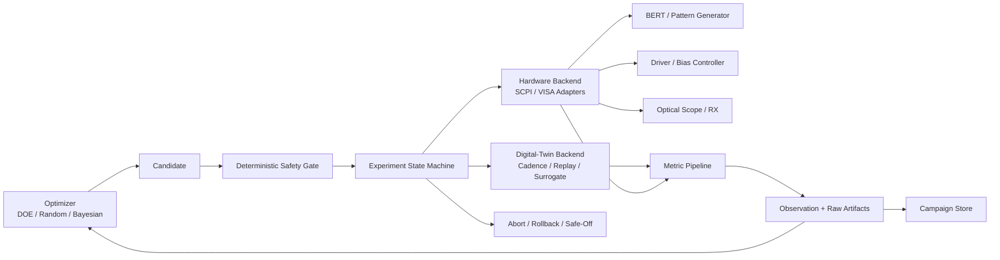

# VCSEL AI 调参平台设计 / VCSEL AI Tuning Platform Design

**日期：** 2026-07-10  
**Date:** 2026-07-10  
**状态：** 设计已批准；实施尚未开始  
**Status:** Approved design; implementation has not started  
**主要范围：** 统一数字孪生与硬件就绪 AI 调参框架的首个实施里程碑  
**Primary scope:** First implementation milestone for a unified digital-twin and hardware-ready AI tuning framework

## 1. 目的 / Purpose

项目已完成基于探针的 DC 和 AC 表征，已将这些结果载入 VCSEL 模型，并完成模型调参。高速眼图测量尚未完成。已观察到 PAM4 眼图倾斜，并将其作为首个需要研究的大信号损伤。
The project has completed probe-based DC and AC characterization, has loaded those results into the VCSEL model, and has tuned the model. High-speed eye-diagram measurements have not yet been completed. PAM4 eye skew has been observed as the first large-signal impairment to investigate.

平台应通过一套实验协议支持两条轨道：
The platform shall support two tracks through one experiment protocol:

1. 使用 Cadence/Verilog-A、回放数据以及后续学习型代理模型的数字孪生轨道；以及  
   a digital-twin track using Cadence/Verilog-A, replay data, and later learned surrogates; and
2. 在选定 BERT、驱动控制器、光示波器和光接收机后，使用确定性 SCPI/VISA 仪器适配器的硬件轨道。  
   a hardware track using deterministic SCPI/VISA instrument adapters once the BERT, driver controller, optical oscilloscope, and optical receiver are selected.

当前直接交付物是共享框架，并不声称硬件调参或符合标准的 TDECQ 测量已经可用。
The immediate product is the shared framework, not a claim that hardware tuning or standards-compliant TDECQ measurement is already available.

## 2. 设计决策 / Design Decisions

### 2.1 选定架构 / Selected architecture

选定的设计是采用可互换后端的统一实验内核。优化器、安全策略、指标模式、实验状态机和制品存储均为共享组件。后端专用代码仅限于仿真运行器和仪器适配器。
The selected design is a unified experiment kernel with interchangeable backends. The optimizer, safety policy, metric schema, experiment state machine, and artifact store are shared. Backend-specific code is limited to simulation runners and instrument adapters.

曾考虑并否决以下两种替代方案：
Two rejected alternatives were considered:

- 分离的仿真与硬件流水线可以加快局部原型开发，但会重复实现安全逻辑、指标定义和配置语义。  
  Separate simulation and hardware pipelines would allow faster local prototypes but would duplicate safety logic, metric definitions, and configuration semantics.
- 厂商优先的实现可以简化初始仪器连接，但在选定型号之前无法启动，并会将平台锁定到单一厂商。  
  A vendor-first implementation would simplify initial instrument connection but cannot start before model selection and would lock the platform to one vendor.

### 2.2 科学顺序 / Scientific ordering

项目应按以下顺序保持因果关系：
The project shall preserve causality in this order:

1. 在保持其他损伤不变的情况下，注入已知倾斜；  
   inject known skew while holding other impairments fixed;
2. 证明倾斜指标能够检测到该注入；  
   show that the skew metric detects the injection;
3. 测量倾斜增大是否会降低公共窗口眼裕量和 BER 相关指标；  
   measure whether increased skew degrades common-window eye margin and BER-related metrics;
4. 优化工程控制量，以在不降低其他眼图指标的情况下减小倾斜；  
   optimize engineering controls to reduce skew without degrading other eye metrics;
5. 在硬件影子模式下验证推荐结果；以及  
   validate recommendations in hardware shadow mode; and
6. 仅在调试验收和重复性门禁通过后，解锁受约束的硬件优化。  
   unlock constrained hardware optimization only after commissioning and repeatability gates pass.

### 2.3 算法顺序 / Algorithm ordering

首个优化器应采用 DOE/网格/随机或 Sobol 搜索。同一接口之后可接入含噪受约束贝叶斯优化器。强化学习和由 LLM 驱动的硬件控制不在首次实施范围内，因为当前任务属于代价高、含噪、有约束的黑箱参数搜索，而不是长时域控制问题。
The first optimizer shall be DOE/grid/random or Sobol search. Noisy constrained Bayesian optimization is a later optimizer behind the same interface. Reinforcement learning and LLM-driven hardware control are outside the first implementation because the present task is an expensive, noisy, constrained black-box parameter search rather than a long-horizon control problem.

## 3. 现有资产与已知缺口 / Current Assets and Known Gaps

### 3.1 可复用资产 / Reusable assets

- `models/vcsel_integrated_physical_100g.va` 是主要的已校准 VCSEL 数字孪生候选模型。  
  `models/vcsel_integrated_physical_100g.va` is the primary calibrated VCSEL digital-twin candidate.
- `models/pam4_voltage_source.va` 提供 53.125 GBd PAM4 激励和显式电压电平。  
  `models/pam4_voltage_source.va` provides a 53.125 GBd PAM4 stimulus and explicit voltage levels.
- `scripts/run_liv_interactive.py` 提供可复用的 PyVISA/Keithley 模式、校验、日志记录和安全关断行为。  
  `scripts/run_liv_interactive.py` provides a reusable PyVISA/Keithley pattern, validation, logging, and safe-off behavior.
- `scripts/run_s11_smu_bias.py` 提供偏置扫描、跳闸处理和运行日志记录模式。  
  `scripts/run_s11_smu_bias.py` provides bias sweep, trip handling, and run logging patterns.
- `simulator2.4/src/simulator.js` 包含先前的眼图统计和搜索概念，可用于辅助接口设计，但其中的经验评分权重不具有规范性。  
  `simulator2.4/src/simulator.js` contains prior eye-statistics and search concepts that may inform interfaces, but its empirical score weights are not normative.
- `repro_2605_18917/` 包含 Bi-LSTM 分帧、归一化、检查点、微调和插值代码，可在具备成对的电输入与光输出波形后使用。  
  `repro_2605_18917/` contains Bi-LSTM framing, normalization, checkpoint, fine-tuning, and interpolation code for later use when paired electrical-input and optical-output waveforms exist.

### 3.2 需要解决且不得静默猜测的缺口 / Gaps to resolve without silently guessing

- `results/DC_LIV_full.csv` 的最后一个数据块在 7 mA 时达到 1.85 mW，而较旧的图表工作簿仍将此前功率更低的数据块描述为最新完整数据块。校准清单必须选择一条规范的数据血缘。  
  The final block in `results/DC_LIV_full.csv` reaches 1.85 mW at 7 mA, while an older chart workbook still describes a previous lower-power block as the latest complete block. A calibration manifest must select one canonical data lineage.
- 工作簿中存在 S11 信息，但仓库不包含原始 Touchstone 文件。偏置映射、校准、去嵌入、孔径和温度元数据均不完整。  
  S11 information exists in workbooks, but the repository does not contain the original Touchstone files. Bias mapping, calibration, de-embedding, aperture, and temperature metadata are incomplete.
- 当前集成 VCSEL 模型未嵌入所提取的外部 `Rm/Ra/Ca/Cp` 网络。对应的 Cadence 网络和配置必须单独进行版本管理。  
  The current integrated VCSEL model does not embed the extracted external `Rm/Ra/Ca/Cp` network. The corresponding Cadence network and configuration must be versioned separately.
- 现有 PAM4 源具有公共上升/下降时间和全局预加重，但无法注入与电平或转换相关的倾斜。  
  The existing PAM4 source has common rise/fall time and global pre-emphasis but cannot inject level- or transition-dependent skew.
- 当前集成模型或硬件尚无可用的原始眼图波形。  
  No raw eye waveform from the current integrated model or hardware is yet available.
- 现有眼图评分强调垂直电平间隔和轨迹厚度；它不提供三个眼中心时刻、公共水平窗口或 `skew/UI`。  
  Existing eye scoring emphasizes vertical level separation and rail thickness; it does not provide three eye-center times, a common horizontal window, or `skew/UI`.

这些缺口不妨碍框架或 fake/replay 后端的建设，但会阻止任何关于 Cadence 或硬件路径已完成端到端校准的声明。
These gaps do not block the framework or fake/replay backends. They block claims that the Cadence or hardware paths are calibrated end to end.

## 4. 架构 / Architecture

Mermaid 图中的节点名称对应如下：优化器（`Optimizer`）、候选点（`Candidate`）、确定性安全门禁（`Deterministic Safety Gate`）、实验状态机（`Experiment State Machine`）、数字孪生后端（`Digital-Twin Backend`）、硬件后端（`Hardware Backend`）、BERT / 码型发生器（`BERT / Pattern Generator`）、驱动 / 偏置控制器（`Driver / Bias Controller`）、光示波器 / 接收机（`Optical Scope / RX`）、指标流水线（`Metric Pipeline`）、观测 + 原始制品（`Observation + Raw Artifacts`）、实验活动存储（`Campaign Store`）以及中止 / 回滚 / 安全关断（`Abort / Rollback / Safe-Off`）。
The Mermaid node labels are mapped as follows: `Optimizer`, `Candidate`, `Deterministic Safety Gate`, `Experiment State Machine`, `Digital-Twin Backend`, `Hardware Backend`, `BERT / Pattern Generator`, `Driver / Bias Controller`, `Optical Scope / RX`, `Metric Pipeline`, `Observation + Raw Artifacts`, `Campaign Store`, and `Abort / Rollback / Safe-Off`.



### 4.1 领域层 / Domain layer

领域层独立于后端定义数据含义：
The domain layer defines the meaning of data independently of a backend:

- `ParameterSpec`：名称、单位、类型、边界、量化、最大步长及控制归属；  
  `ParameterSpec`: name, unit, type, bounds, quantization, maximum step, and ownership;
- `Candidate`：请求的参数值和上下文；  
  `Candidate`: requested parameter values and context;
- `AppliedSettings`：请求值、量化值、施加值和读回值；  
  `AppliedSettings`: requested, quantized, applied, and read-back values;
- `MeasurementPlan`：快速或标准测量定义；  
  `MeasurementPlan`: fast or standard measurement definition;
- `MetricValue`：值、单位、保真度、方法版本、有效性和不确定度；  
  `MetricValue`: value, unit, fidelity, method version, validity, and uncertainty;
- `Observation`：设置、上下文、指标、约束、状态和制品引用；  
  `Observation`: settings, context, metrics, constraints, status, and artifact references;
- `SafetyPolicy`：确定性限制和联锁；以及  
  `SafetyPolicy`: deterministic limits and interlocks; and
- `CampaignConfig`：后端、参数空间、预算、种子、目标和测量计划。  
  `CampaignConfig`: backend, parameter space, budget, seed, objective, and measurement plan.

### 4.2 实验引擎 / Experiment engine

实验引擎是唯一允许执行候选点的组件。优化器不能直接调用仪器适配器。引擎负责预检、安全校验、施加、读回、稳定等待、测量、有效性检查、持久化和回滚。
The experiment engine is the only component allowed to execute a candidate. An optimizer cannot call an instrument adapter directly. The engine performs preflight, safety validation, apply, read-back, settle, measurement, validity checks, persistence, and rollback.

### 4.3 后端 / Backends

所有后端都实现相同的实验契约：
All backends implement the same experiment contract:

- `FakeHardwareBackend` 在没有仪器的情况下验证状态转换和故障行为。  
  `FakeHardwareBackend` verifies state transitions and fault behavior without instruments.
- `ReplayBackend` 从已知测试样本返回带版本的观测。  
  `ReplayBackend` returns versioned observations from known fixtures.
- `CadenceBackend` 后续将渲染运行配置、启动已批准的仿真器命令、捕获日志并解析原始波形。  
  `CadenceBackend` later renders a run configuration, launches the approved simulator command, captures logs, and parses raw waveforms.
- `HardwareBackend` 组合相互独立的 BERT、驱动/偏置以及示波器/RX 适配器。  
  `HardwareBackend` composes independent BERT, driver/bias, and scope/RX adapters.
- 学习型代理模型是可选组件，并且必须保持为独立的保真度；它绝不能取代硬件安全检查。  
  A learned surrogate is optional and must remain a distinct fidelity; it never replaces hardware safety checks.

硬件适配器公开 `identify`、`configure`、`apply`、`readback`、`measure`、`abort` 和 `safe_off`。厂商 SCPI 命令保留在 profile 或适配器包内部。
Hardware adapters expose `identify`, `configure`, `apply`, `readback`, `measure`, `abort`, and `safe_off`. Vendor SCPI commands remain inside a profile or adapter package.

每个真实适配器都必须验证仪器身份、查询实际施加的设置、通过仪器状态机制同步持续时间可变的操作、清空错误队列、拒绝无效测量状态，并公开幂等的安全关断操作。固定 sleep 延迟可以补充已记录的稳定等待要求，但不能替代仪器完成、码型锁定或链路同步检查。
Each real adapter must verify instrument identity, query actual applied settings, synchronize variable-duration operations through the instrument status mechanism, drain the error queue, reject invalid measurement status, and expose an idempotent safe-off operation. Fixed sleep delays may supplement a documented settling requirement but cannot substitute for instrument completion, pattern lock, or link synchronization checks.

### 4.4 指标流水线 / Metric pipeline

指标流水线接收原始波形或仪器结果，并生成带版本的指标。硬件标准结果与仿真代理指标使用不同的指标名称和保真度标签。尤其是，`tdecq_proxy` 绝不能存储为 `tdecq_db`。
The metric pipeline receives raw waveforms or instrument results and produces versioned metrics. Hardware-standard results and simulation proxies use different metric names and fidelity labels. In particular, `tdecq_proxy` shall never be stored as `tdecq_db`.

### 4.5 实验活动存储与用户界面 / Campaign store and user interface

首次实施使用本地 SQLite 数据库保存可查询的元数据，并使用文件系统制品保存波形、眼图、设置文件和日志。Pydantic 模型和 JSON Schema 用于校验外部数据。CLI 和 YAML 配置是首个用户界面；Dashboard 是后续使用同一内核的消费者。
The first implementation uses a local SQLite database for queryable metadata plus filesystem artifacts for waveforms, eye images, setup files, and logs. Pydantic models and JSON Schema validate external data. A CLI and YAML configuration are the first user interface; a dashboard is a later consumer of the same kernel.

制品先写入临时运行路径，完成哈希后再以原子方式提升；随后 SQLite 事务才会公开有效观测。优化器不能使用仅部分持久化的运行结果。
Artifacts are written to temporary run paths, hashed, and atomically promoted before the SQLite transaction exposes a valid observation. An optimizer cannot consume a partially persisted run.

## 5. 数据契约与溯源 / Data Contract and Provenance

### 5.1 必需的实验活动文件 / Required campaign files

- `campaign.yaml` 冻结后端、参数空间、安全策略、测量计划、优化器、预算、种子和目标。  
  `campaign.yaml` freezes backend, parameter space, safety policy, measurement plan, optimizer, budget, seed, and objective.
- `calibration_manifest.yaml` 冻结器件、温度、DC/AC 源数据、模型文件、模型参数、外部 RC 网络和内容哈希。  
  `calibration_manifest.yaml` freezes device, temperature, DC/AC source data, model file, model parameters, external RC network, and content hashes.
- `candidate.json` 存储请求的设置和转换后的设置。  
  `candidate.json` stores requested and transformed settings.
- `observation.json` 存储施加值/读回值、上下文、指标、约束、有效性和制品。  
  `observation.json` stores applied/read-back values, context, metrics, constraints, validity, and artifacts.
- `events.jsonl` 是仅追加的状态转换与错误日志。  
  `events.jsonl` is an append-only state-transition and error log.

### 5.2 制品布局 / Artifact layout

```text
artifacts/campaigns/<campaign_id>/runs/<run_id>/
|-- candidate.json
|-- observation.json
|-- events.jsonl
|-- waveform.*
|-- eye.png
|-- instrument_setup.*
`-- logs/
```

### 5.3 保真度分类 / Fidelity taxonomy

- `simulation_proxy`：倾斜、三个眼中心、公共眼窗、最差眼高/眼宽、RLM 代理指标、过冲、振铃、仿真电流和仿真功率。  
  `simulation_proxy`: skew, three eye centers, common eye window, worst eye height/width, RLM proxy, overshoot, ringing, simulated current, and simulated power.
- `hardware_fast`：施加设置值/读回设置值、锁定/同步、AOP、OMA、ER、快速 RLM、误码数和已测试比特数。  
  `hardware_fast`: applied/read-back settings, lock/sync, AOP, OMA, ER, fast RLM, error count, and tested bits.
- `hardware_standard`：按标准配置的 TDECQ/RLM、长时间 BER、抖动分解和浴盆曲线结果。  
  `hardware_standard`: standards-configured TDECQ/RLM, long BER, jitter decomposition, and bathtub results.

每个指标均存储 `value`、`unit`、`fidelity`、`method_version`、`uncertainty`、`validity` 和 `measurement_definition_id`。
Every metric stores `value`, `unit`, `fidelity`, `method_version`, `uncertainty`, `validity`, and `measurement_definition_id`.

BER 绝不会仅以小数形式存储。记录中包括误码数、已测试比特数、置信度方法和置信上界。零误码运行不会被记录为精确的零 BER。
BER is never stored only as a decimal. The record includes error count, tested bits, confidence method, and upper confidence bound. A zero-error run is not recorded as exact zero BER.

### 5.4 硬件解锁规则 / Hardware unlock rules

在满足以下所有条件且通过调试验收测试之前，硬件后端保持 dry-run：
The hardware backend remains in dry-run until all of the following exist and pass commissioning tests:

- 经操作员验证的安全基线；  
  an operator-verified safe baseline;
- 明确的电流、电压、偏置、调制、温度、光功率、抽头、电平顺序和最大步长限制；  
  explicit current, voltage, bias, modulation, temperature, optical-power, tap, level-order, and maximum-step limits;
- 仪器身份、固件、校准状态和远程控制配置；  
  instrument identity, firmware, calibration status, and remote-control configuration;
- 已测试的中止和安全关断行为；以及  
  tested abort and safe-off behavior; and
- 由一个控制进程独占仪器会话。  
  exclusive ownership of the instrument sessions by one control process.

还必须配置并验证仪器端 compliance 限制和可用的物理联锁。软件安全检查是额外的一层保护，并非保护 VCSEL 或测试设备的唯一手段。
Instrument-side compliance limits and available physical interlocks must also be configured and verified. Software safety checks are an additional layer and are not the sole protection for the VCSEL or test equipment.

## 6. 眼图倾斜与链路指标 / Eye-Skew and Link Metrics

### 6.1 主要倾斜定义 / Primary skew definition

令 `t01`、`t12` 和 `t23` 分别为同一时间参考下 PAM4 下眼、中眼和上眼的中心。主要诊断指标为：
Let `t01`, `t12`, and `t23` be the centers of the lower, middle, and upper PAM4 eyes under the same time reference. The primary diagnostic is:

```text
skew_pp_ui = (max(t01, t12, t23) - min(t01, t12, t23)) / UI
```

平台还存储每个有符号的眼中心偏移。眼高和眼宽既在公共采样参考下评估，也在每只眼各自的最优点处评估，从而避免各眼独立居中掩盖倾斜。
The platform also stores each signed eye-center offset. Eye heights and widths are evaluated at a common sampling reference as well as per-eye optima so that independent per-eye centering cannot hide skew.

### 6.2 最小快速指标集 / Minimum fast metric set

- `skew_pp_ui` 和有符号眼中心偏移；  
  `skew_pp_ui` and signed eye-center offsets;
- 公共窗口眼宽和各眼眼宽；  
  common-window and per-eye eye widths;
- 三个眼高和最差眼高；  
  three eye heights and the worst eye height;
- PAM4 电平均值、轨迹厚度、电平间距和 `rlm_proxy`；  
  PAM4 level means, rail thickness, level spacing, and `rlm_proxy`;
- 过冲、下冲、振铃、转换时间以及上升/下降不对称性；  
  overshoot, undershoot, ringing, transition times, and rise/fall asymmetry;
- 电流、电压、光功率、电功率、温度、锁定和同步状态；以及  
  current, voltage, optical power, electrical power, temperature, lock, and sync status; and
- 存在 BERT 结果时的误码数和已测试比特数。  
  error count and tested bits when a BERT result exists.

### 6.3 标准测量规则 / Standard measurement rule

按标准配置的 TDECQ 取决于所选 PMD、码型、参考接收机/滤波器、CDR、均衡器、光信道和测量实现。因此，平台将这些内容存储为测量定义标识。平台不会从眼图截图或任意仿真眼图推断符合标准的 TDECQ 值。
Standards-configured TDECQ depends on the selected PMD, pattern, reference receiver/filter, CDR, equalizer, optical channel, and measurement implementation. The platform therefore stores these as a measurement-definition identity. It does not infer a standards-compliant TDECQ value from an eye screenshot or an arbitrary simulated eye.

## 7. 活动工作流 / Campaign Workflow

### 7.1 活动 A：倾斜因果验证 / Campaign A: causal skew validation

在保持幅度、噪声、ISI、抖动、判决器行为及其他模型设置不变的情况下，分别注入 0、0.03、0.06 和 0.10 UI 的转换相关或电平相关延迟。全局波形延迟作为负对照，因为它应当只平移眼图，而不改变 `skew_pp_ui`。

Inject transition- or level-dependent delay at 0, 0.03, 0.06, and 0.10 UI while keeping amplitude, noise, ISI, jitter, slicer behavior, and other model settings fixed. A global waveform delay is a negative control because it should shift the eye without changing `skew_pp_ui`.

该活动用于证明：

The campaign demonstrates:

- 能够恢复已知的注入倾斜；  
  recovery of the known injected skew;
- 公共眼窗和最差眼指标发生的变化；以及  
  change in the common eye window and worst-eye metrics; and
- 在控制其他损伤后，BER 代理指标或实测 BER 是否下降。  
  whether BER proxy or measured BER degrades after controlling other impairments.

### 7.2 活动 B：数字孪生倾斜修复 / Campaign B: digital-twin skew repair

初始可调参数集包含从以下控制量中选出的四至八个工程控制量：

The initial tunable set contains four to eight engineering controls selected from:

- 偏置与调制/摆幅；  
  bias and modulation/swing;
- 三个正的 PAM4 电平间距，而不是四个无约束电平；  
  three positive PAM4 level spacings rather than four unconstrained levels;
- 一组小规模归一化 FFE 抽头；以及  
  a small normalized FFE tap set; and
- 转换相关预加重参数。  
  transition-dependent pre-emphasis parameters.

已校准的 VCSEL 内部参数和已接受的外部 RC 网络保持固定。

Calibrated VCSEL internal parameters and the accepted external RC network remain fixed.

候选点采用词典序排名：

Candidate ranking is lexicographic:

1. 所有确定性约束和物理约束均通过；  
   all deterministic and physical constraints pass;
2. 最小化 `skew_pp_ui`；  
   minimize `skew_pp_ui`;
3. 最差眼高、最差眼宽和 RLM 代理指标的退化不超过已配置的基线容差；以及  
   worst eye height, worst eye width, and RLM proxy do not degrade beyond configured baseline tolerances; and
4. 以降低功耗作为打破平局的准则。  
   reduce power as a tie-breaker.

### 7.3 活动 C：硬件影子模式 / Campaign C: hardware shadow mode

系统重复测量由操作员定义的基线，验证设置/读回和锁定行为，在基线附近执行小型分块 DOE，并在每个硬件测试点记录数字孪生预测。AI 仅推荐设置，不能自动写入设置。

The system measures a repeated operator-defined baseline, validates set/read-back and lock behavior, executes a small blocked DOE around the baseline, and records the digital-twin prediction at every hardware point. The AI recommends settings but cannot write them automatically.

### 7.4 活动 D：双速硬件闭环 / Campaign D: dual-speed hardware loop

快速内环测量倾斜、最差眼指标、RLM、功耗、锁定状态和短 BER。只有通过全部门禁的候选点才进入慢速外环，开展按标准配置的 TDECQ、长 BER、浴盆曲线以及留出温度/码型检查。

The fast inner loop measures skew, worst-eye metrics, RLM, power, lock, and short BER. Only candidates that pass all gates enter the slow outer loop for standards-configured TDECQ, long BER, bathtub, and held-out temperature/pattern checks.

当配对数据足以支持时，平台可按以下形式对硬件行为建模：

When paired data justify it, the platform may model hardware behavior as:

```text
y_hw(x, c) = rho(x, c) * m_sim(x, c) + delta(x, c) + epsilon(x, c)
```

如果留出残差检查表明数字孪生不再有用，活动将回退到仅硬件优化，而不是强行将仿真观测与硬件观测归入同一分布。

If held-out residual checks show that the digital twin is no longer useful, the campaign falls back to hardware-only optimization rather than forcing simulated and hardware observations into one distribution.

## 8. 优化器策略 / Optimizer Strategy

### 8.1 首次实施 / First implementation

首次实施提供确定性的网格/随机/Sobol 候选点生成、预算执行、带种子的重放、词典序排名以及有效观测过滤。

The first implementation provides deterministic grid/random/Sobol candidate generation, budget enforcement, seeded replay, lexicographic ranking, and valid-observation filtering.

### 8.2 后续受约束优化 / Later constrained optimization

在重复观测能够表征测量噪声后，后续里程碑可以加入含噪受约束贝叶斯优化。使用独立模型分别表示目标和黑盒结果约束。只有在 TDECQ、BER 和功耗呈现出无法通过可行性约束和打破平局规则表达的、已经得到证实的权衡时，才引入多目标优化。

Once repeated observations characterize measurement noise, a later milestone may add noisy constrained Bayesian optimization. Separate models represent the objective and black-box outcome constraints. Multi-objective optimization is introduced only when TDECQ, BER, and power exhibit a demonstrated trade-off that cannot be represented by feasibility constraints and tie-breaking.

贝叶斯模型使用实际施加值/读回值，而不是未经量化的请求值。温度、器件、光纤/发射条件、时间及其他实测环境变量作为上下文。通过重复测量锚点检测漂移。

The Bayesian model consumes applied/read-back settings, not unquantized requested settings. Temperature, device, fiber/launch condition, time, and other measured environment variables are context. Repeated anchors detect drift.

## 9. 安全与错误处理 / Safety and Error Handling

### 9.1 状态机 / State machine

```text
IDLE
-> PREFLIGHT
-> ARMED
-> APPLY
-> READBACK
-> SETTLE
-> MEASURE_FAST
-> VALIDATE
-> MEASURE_SLOW (optional)
-> COMMIT
-> COMPLETE
```

任何状态都可以转换至：

Any state may transition to:

```text
ROLLBACK -> SAFE_OFF -> ABORTED
```

回滚目标是最近一次重新验证过的安全基线或安全最优点，而不仅仅是上一个候选点。

The rollback target is the most recently revalidated safe baseline or safe incumbent, not merely the previous candidate.

### 9.2 故障策略 / Failure policy

- 过流、过温、光功率违规、失锁、读回不匹配、联锁触发或用户中止，将导致立即安全关断，且不自动重试。  
  Over-current, over-temperature, optical-power violation, unlock, read-back mismatch, interlock, or user abort causes immediate safe-off with no automatic retry.
- VISA 断开或 SCPI 超时会先导致安全关断，之后最多尝试重新连接一次。执行绝不会从不确定的仪器状态恢复。  
  VISA disconnect or SCPI timeout causes safe-off before at most one reconnect attempt. Execution never resumes from an uncertain instrument state.
- NaN、仪器哨兵值、无效测量状态或不完整元数据将产生无效观测，并从优化器中排除。只有在返回安全基线后，才允许重新采集一次。  
  NaN, instrument sentinel values, invalid measurement status, or incomplete metadata produce an invalid observation excluded from the optimizer. A single reacquisition is allowed only after returning to the safe baseline.
- Cadence 失败时记录日志并跳过该候选点，不影响硬件状态。  
  Cadence failure records logs and skips the candidate without affecting hardware state.
- 在系统布防后，如果制品或数据库持久化失败，将触发安全关断和中止；不完整运行会被隔离，且绝不向优化器公开。  
  Artifact or database persistence failure after arming causes safe-off and abort; the incomplete run is quarantined and never exposed to the optimizer.
- 基线漂移或残差漂移将冻结优化，并要求重新测量锚点和复核校准。  
  Baseline or residual drift freezes optimization and requires anchor remeasurement and recalibration review.

在进程或 PC 意外重启后，任何非终态硬件运行均视为状态不确定。下一个会话以未布防状态启动，识别每台仪器、读回其状态、调用已批准的安全关断序列，并要求操作员确认后，才允许再次对活动进行布防。

After an unexpected process or PC restart, any nonterminal hardware run is treated as uncertain. The next session begins disarmed, identifies every instrument, reads back its state, invokes the approved safe-off sequence, and requires operator acknowledgement before another campaign can arm.

只有同时有效且可行的观测才会向优化器公开。

Only observations that are both valid and feasible are exposed to an optimizer.

## 10. 测试与验收 / Testing and Acceptance

### 10.1 单元测试与科学测试 / Unit and scientific tests

- 合成 PAM4 测试样本注入 0、0.03、0.06 和 0.10 UI 倾斜。测量误差不得大于 `max(0.005 UI, 注入值的 10%)`。  
  Synthetic PAM4 fixtures inject 0, 0.03, 0.06, and 0.10 UI skew. Measured error shall be no greater than `max(0.005 UI, 10% of the injected value)`.
- 全局延迟负对照所导致的实测倾斜变化不得超过 0.005 UI。  
  A global-delay negative control shall not change measured skew beyond 0.005 UI.
- 测试覆盖 PAM4 电平单调性、FFE 归一化、单位、BER 置信度计算、基线容差和所有安全边界。  
  Tests cover PAM4 level monotonicity, FFE normalization, units, BER confidence calculation, baseline tolerances, and all safety boundaries.

### 10.2 契约测试与故障注入测试 / Contract and fault-injection tests

- 同一套后端与适配器契约测试套件针对模拟实现、重放实现以及后续真实实现运行。  
  The same backend and adapter contract suite runs against fake, replay, and later real implementations.
- 在适用的情况下，向每个实验状态注入超时、无效数据、失锁、用户中止和持久化故障。  
  Every experiment state receives injected timeout, invalid data, unlock, user abort, and persistence failures where applicable.
- 每一种不安全或状态不确定的硬件路径故障都必须以 `SAFE_OFF` 结束，或保持在未布防状态。  
  Every unsafe or uncertain hardware-path failure must end in `SAFE_OFF` or remain in a non-armed state.
- 固定种子的重放活动生成相同的候选点序列、观测和报告。  
  A fixed-seed replay campaign produces the same candidate sequence, observations, and report.

### 10.3 首个里程碑验收 / First-milestone acceptance

满足以下条件时，首次实施里程碑即告完成：

The first implementation milestone is complete when:

- CLI 能够验证活动和校准清单；  
  the CLI validates a campaign and calibration manifest;
- 模拟硬件活动能够端到端执行并持久化全部制品；  
  a fake-hardware campaign executes end to end and persists all artifacts;
- 重放数字孪生活动能够确定性执行；  
  a replay digital-twin campaign executes deterministically;
- 已知倾斜的测试样本通过指标容差要求；  
  the known-skew fixtures pass the metric tolerances;
- 适配器 dry-run 契约测试覆盖 BERT、driver/bias 和 scope/RX 角色；  
  adapter dry-run contract tests cover BERT, driver/bias, and scope/RX roles;
- 故障注入能够证明回滚和安全关断行为；以及  
  fault injection proves rollback and safe-off behavior; and
- 能够根据已存储观测生成基线比较报告。  
  a baseline-comparison report is generated from stored observations.

通过该里程碑并不授权写入真实硬件，也不宣称已完成 Cadence 校准、符合 TDECQ 标准或实现 BER 改善。

Passing this milestone does not authorize real hardware writes or claim Cadence calibration, TDECQ compliance, or BER improvement.

## 11. 实施范围与里程碑 / Implementation Scope and Milestones

### 里程碑 1：基础与双后端契约 / Milestone 1: foundation and dual-backend contracts

这是下一份实施计划，包含：

This is the next implementation plan. It includes:

- Python 包、CLI、YAML/Pydantic 配置、SQLite 元数据和文件系统制品；  
  Python package, CLI, YAML/Pydantic configuration, SQLite metadata, and filesystem artifacts;
- 领域模型、实验状态机、安全策略和事件日志；  
  domain models, experiment state machine, safety policy, and event logging;
- 模拟硬件后端和重放后端；  
  fake-hardware and replay backends;
- Cadence 后端接口和硬件后端接口；  
  Cadence and hardware backend interfaces;
- 倾斜、眼中心、公共眼窗、最差眼和 RLM 代理指标；  
  skew, eye-center, common-window, worst-eye, and RLM-proxy metrics;
- DOE/随机/Sobol 候选点生成；以及  
  DOE/random/Sobol candidate generation; and
- 确定性报告和测试。  
  deterministic reports and tests.

### 里程碑 2：Cadence 执行与可控倾斜 / Milestone 2: Cadence execution and controllable skew

该里程碑需要已批准的 Cadence 测试平台/网表、仿真器命令、外部 RC 网络、参数映射和原始波形格式。该里程碑实施实际 Cadence 后端和可控倾斜源。

This milestone requires the approved Cadence testbench/netlist, simulator command, external RC network, parameter mapping, and raw waveform format. It implements the actual Cadence backend and a controllable skew source.

### 里程碑 3：仪器调试验收与影子模式 / Milestone 3: instrument commissioning and shadow mode

该里程碑在选定仪器型号后开始。它将增加厂商适配器、设置配置文件、独占会话、快速测量采集、调试验收测试以及经操作员批准的影子活动。

This milestone begins after instrument models are selected. It adds vendor adapters, setup profiles, exclusive sessions, fast measurement acquisition, commissioning tests, and operator-approved shadow campaigns.

### 里程碑 4：受约束与多保真优化 / Milestone 4: constrained and multi-fidelity optimization

该里程碑增加含噪受约束贝叶斯优化、配对仿真/硬件残差模型、上下文与漂移处理，以及双速候选点晋级机制。

This milestone adds noisy constrained Bayesian optimization, paired simulation/hardware residual models, context and drift handling, and dual-speed candidate promotion.

Dashboard 开发、Bi-LSTM 在线训练、强化学习、LLM 硬件决策和厂商特定的 TDECQ 重新实现不属于里程碑 1 的范围。

Dashboard development, Bi-LSTM online training, reinforcement learning, LLM hardware decisions, and vendor-specific TDECQ reimplementation are outside Milestone 1.

## 12. 数据移交检查清单 / Data Handoff Checklist

里程碑 1 可使用仓库中的测试样本。里程碑 2 需要：

Milestone 1 can use repository fixtures. Milestone 2 requires:

- 规范的最终 DC 数据集，以及确认 7 mA、1.85 mW 锚点所代表的器件/运行/温度；  
  the canonical final DC dataset and confirmation of the device/run/temperature represented by the 7 mA, 1.85 mW anchor;
- 原始 S11 Touchstone 文件或完整频域导出，包括偏置映射、校准、去嵌、孔径和温度信息；  
  original S11 Touchstone or complete frequency-domain exports, including bias mapping, calibration, de-embedding, aperture, and temperature information;
- 当前 Cadence 原理图/测试平台或导出网表、仿真器调用方法、模型参数文件、外部 RC 网络和波形输出格式；以及  
  the current Cadence schematic/testbench or exported netlist, simulator invocation method, model parameter file, external RC network, and waveform output format; and
- 机器可读形式的已接受校准参数集。  
  the accepted calibration parameter set in a machine-readable form.

里程碑 3 还需要：

Milestone 3 additionally requires:

- BERT/码型发生器、驱动器控制器、光示波器和光接收机型号；  
  BERT/pattern-generator, driver controller, optical scope, and optical receiver models;
- 固件、远程接口、编程手册、已安装选件、校准状态和 PC 连接方式；  
  firmware, remote interface, programming manuals, installed options, calibration status, and PC connectivity;
- 经操作员批准的安全基线和硬限制；以及  
  an operator-approved safe baseline and hard limits; and
- 原始眼图波形、仪器设置文件、码型/波特率/CDR/滤波器/均衡器元数据、误码数和已测试比特数。  
  raw eye waveforms, instrument setup files, pattern/baud/CDR/filter/equalizer metadata, error count, and tested-bit count.

## 13. 研究依据 / Research Basis

- IEEE 802.3db-2022 定义了适用的 100 Gb/s、200 Gb/s 和 400 Gb/s 短距光 PMD。  
  IEEE 802.3db-2022 defines applicable 100 Gb/s, 200 Gb/s, and 400 Gb/s short-reach optical PMDs: <https://standards.ieee.org/ieee/802.3db/10283/>
- Keysight TDECQ 测量指南说明了参考接收机、码型锁定、滤波、均衡和测量条件。  
  Keysight TDECQ measurement guidance explains reference-receiver, pattern-lock, filtering, equalization, and measurement conditions: <https://helpfiles.keysight.com/scopes/FlexDCA-UG/Content/Topics/Eye-Mask-Mode/PAM-Measurements/pam_tdecq.htm>
- FlexDCA Programmer's Guide 记录了 IEEE 488.2/SCPI 自动化和测量同步。  
  The FlexDCA Programmer's Guide documents IEEE 488.2/SCPI automation and measurement synchronization: <https://helpfiles.keysight.com/scopes/FlexDCA-PG/Content/Topics/FlexDCA-PG-Home.htm>
- SafeOpt 为安全约束贝叶斯探索提供研究依据，但不能替代确定性联锁。  
  SafeOpt provides a research basis for safety-constrained Bayesian exploration but does not replace deterministic interlocks: <https://proceedings.mlr.press/v37/sui15.html>
- 受约束贝叶斯优化对目标和未知结果约束进行建模。  
  Constrained Bayesian optimization models objective and unknown outcome constraints: <https://proceedings.mlr.press/v32/gardner14.html>
- BoTorch 记录了贝叶斯优化中现代结果约束的处理方式。  
  BoTorch documents modern outcome-constraint handling for Bayesian optimization: <https://botorch.org/docs/constraints>
- VCSEL PAM4 Bi-LSTM 仿真器研究支持在存在配对波形数据后使用学习型动态代理模型。  
  The VCSEL PAM4 Bi-LSTM emulator work supports learned dynamic surrogates after paired waveform data exist: <https://doi.org/10.1364/AO.588513>
