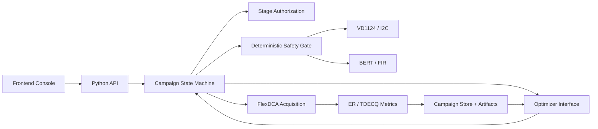

# VCSEL Hierarchical AI Tuning Design / VCSEL 分层 AI 调优设计

**Date / 日期:** 2026-07-22
**Status / 状态:** Approved for development prompts / 已批准用于生成开发 Prompt
**Scope / 范围:** VD1124 I²C inner-loop tuning, BERT FIR outer-loop tuning, FlexDCA ER/TDECQ feedback, stage-scoped authorization / VD1124 I²C 内层调优、BERT FIR 外层调优、FlexDCA ER/TDECQ 反馈与分阶段授权

## 1. Purpose / 目标

Build a reproducible, auditable, and hardware-safe hierarchical tuning campaign. Every campaign starts from one frozen baseline, uses ER to reach the TDECQ-measurable region, minimizes TDECQ under an ER constraint, and only then considers a bounded FIR update.

构建可复现、可审计且对硬件安全的分层调优任务。每个任务从唯一冻结基线开始，先使用 ER 进入可测 TDECQ 的区域，再在 ER 约束下最小化 TDECQ，最后才考虑受限的 FIR 更新。

The optimizer never talks directly to instruments. Deterministic orchestration, authorization, safety validation, readback, persistence, and rollback remain outside the AI model.

优化器绝不直接访问仪器。确定性的编排、授权、安全检查、回读、持久化和回滚均位于 AI 模型之外。

## 2. Frozen Baseline B0 / 冻结基线 B0

Every campaign starts from baseline `B0`. The stored baseline is versioned and hashed when a campaign is created. Historical campaigns always retain the exact baseline they used.

每个任务均从 `B0` 开始。创建任务时必须冻结基线版本并计算哈希；历史任务始终保留当时使用的精确基线。

### 2.1 Pattern, FIR, and NLC / 码型、FIR 与 NLC

| Setting / 设置 | Value / 值 |
| --- | ---: |
| Pattern | `SSPRQ` |
| Pre-1 | -28 |
| Pre-2 | 9 |
| Pre-3 | 0 |
| Main | 104 |
| Post-1 | -8 |
| Post-2 | 1 |
| Post-3 | -3 |
| Upper NLC | 6 |
| Lower NLC | 6 |

The canonical internal tap order is `(Pre3, Pre2, Pre1, Main, Post1, Post2, Post3)`:

内部统一 tap 顺序为 `(Pre3, Pre2, Pre1, Main, Post1, Post2, Post3)`：

```text
(0, 9, -28, 104, -8, 1, -3)
```

The vendor command order is `(Pre1, Pre2, Pre3, Main, Post1, Post2, Post3, UpperNLC, LowerNLC)`. The corresponding payload is:

厂商命令顺序为 `(Pre1, Pre2, Pre3, Main, Post1, Post2, Post3, UpperNLC, LowerNLC)`，对应载荷为：

```text
setFir port1 0 -28 9 0 104 -8 1 -3 6 6
```

The B0 FIR L1 norm is 153 and satisfies the repository limit `L1 <= 170`.

B0 FIR 的 L1 范数为 153，满足仓库现有的 `L1 <= 170` 限制。

### 2.2 VD1124 I²C baseline / VD1124 I²C 基线

| Parameter / 参数 | Channel-0 address / 通道 0 地址 | Bits / 位宽 | B0 |
| --- | ---: | ---: | ---: |
| `ibias_dac` | `0x2002` | 7 | 70 |
| `efin_cur` | `0x2003` | 4 | 15 |
| `vga_cur` | `0x2005` | 4 | 13 |
| `eq` | `0x2006` | 5 | 22 |
| `res_gain` | `0x2007` | 4 | 6 |
| `res_bw` | `0x2008` | 4 | 0 |
| `gain_ctrl` | `0x2009` | 6 | 5 |
| `vbias_ref` | `0x200A` | 4 | 15 |
| `vref` | `0x200B` | 4 | 15 |

The I²C address is `0xA6`; channel 0 is enabled and other channels remain disabled. Third-party comments such as `fixed`, `100`, `110`, `120`, and `step=3` are not requirements and do not constrain the optimizer.

I²C 地址为 `0xA6`；channel 0 启用，其他通道保持禁用。第三方备注中的 `fixed`、`100`、`110`、`120` 和 `step=3` 均不属于需求，也不约束优化器。

## 3. Safety Boundary Model / 安全边界模型

Three different ranges must remain separate:

三种范围必须保持分离：

```text
AI tuning authorization range
  subset of experimental safe operating range
    subset of I²C encodable range
```

```text
AI 调优授权范围
  属于实验安全工作范围的保守子集
    实验安全范围又位于 I²C 可编码范围内
```

Register width proves only that a value can be encoded. It does not prove that the value or a combination of values is safe for the connected VCSEL, driver, board, supply, and temperature.

寄存器位宽只证明数字可以编码，并不证明该数字或多个数字的组合对当前 VCSEL、Driver、板级供电和温度条件安全。

Every tunable parameter therefore has an encoding range, an operator-configured tuning range, a maximum per-candidate step, and an enabled flag. Missing tuning limits disable real tuning for that parameter.

因此，每个可调参数都必须具有编码范围、操作者配置的调优范围、单候选最大步长和启用标志。缺少调优边界时，该参数不得进入真实调优。

## 4. Selected Architecture / 选定架构

The system uses one campaign state machine with separate hardware adapters, authorization, deterministic safety, optimizer, metric processing, and storage components.

系统采用统一的 Campaign 状态机，并将硬件适配器、授权、确定性安全检查、优化器、指标处理和存储拆分为独立组件。



Only the campaign orchestrator may request hardware actions. The optimizer returns candidates, predictions, reasons, and convergence decisions; it cannot return raw I²C frames or BERT commands.

只有 Campaign Orchestrator 可以请求硬件动作。优化器只返回候选点、预测、理由和收敛判断，不得返回原始 I²C 帧或 BERT 命令。

## 5. Authorization Strategy / 授权策略

Version 1 uses `PER_STAGE` authorization. The data model reserves `PER_CANDIDATE` and `FULL_CAMPAIGN`, but `FULL_CAMPAIGN` remains disabled until hardware ranges, settling behavior, rollback, and convergence are validated.

第一版使用 `PER_STAGE` 授权。数据模型预留 `PER_CANDIDATE` 和 `FULL_CAMPAIGN`，但在硬件范围、稳定时间、回滚和收敛得到验证前，`FULL_CAMPAIGN` 必须保持禁用。

An authorization freezes the allowed parameters, ranges, maximum steps, candidate budget, duration, baseline hash, rollback snapshot, and expiration. A candidate outside this envelope is rejected before any hardware call.

每次授权冻结允许参数、范围、最大步长、候选预算、运行时间、基线哈希、回滚快照和过期时间。超出授权包的候选点必须在任何硬件调用前被拒绝。

Rollback to the stage-entry snapshot is pre-authorized with the stage. Recovery must not wait for a second operator approval after a failure.

恢复到阶段入口快照必须与阶段一同预授权，故障后不得等待第二次人工批准才开始回滚。

## 6. Campaign State Machine / Campaign 状态机

Normal states are:

正常状态为：

```text
DRAFT
-> PREFLIGHT
-> AWAIT_BASELINE_APPROVAL
-> RESTORE_B0
-> BASELINE_MEASUREMENT
-> AWAIT_COARSE_APPROVAL
-> I2C_SCREENING
-> I2C_COARSE
-> AWAIT_FINE_APPROVAL
-> I2C_FINE
-> AWAIT_FIR_APPROVAL
-> FIR_APPLY
-> I2C_RETUNE
-> FINAL_VERIFICATION
-> COMPLETED
```

Exceptional or operator-controlled states are:

异常或操作者控制状态为：

```text
PAUSED
ABORTING
ROLLING_BACK
FAILED
RECOVERY_REQUIRED
```

The frontend may disconnect without terminating a campaign. State and events are persisted before being exposed to the UI or optimizer.

前端断线不得终止 Campaign。状态和事件必须先持久化，再暴露给前端或优化器。

## 7. Tuning Stages and Convergence / 调优阶段与收敛

### 7.1 Preflight and B0 characterization / 预检与 B0 标定

Preflight verifies instrument identity, configuration, readback, and absence of unresolved recovery state. It is read-only. After stage authorization, the engine restores or verifies B0 and performs five independent DCA Single measurements.

Preflight 验证仪器身份、配置、回读和不存在未解决的恢复状态，全程只读。阶段获批后，状态机恢复或确认 B0，并执行 5 次相互独立的 DCA Single 测量。

At least four of five acquisitions and four of five ER results must be valid. Missing TDECQ does not block coarse tuning. Baseline output includes ER/TDECQ median, sample deviation, validity rate, raw responses, and timing.

至少 4/5 次采集和 4/5 次 ER 必须有效。TDECQ 缺失不阻止粗调。基线输出 ER/TDECQ 中位数、样本标准差、有效率、原始响应和耗时。

### 7.2 I²C sensitivity screening / I²C 敏感度筛选

With B0 FIR and NLC fixed, the engine perturbs one authorized I²C parameter at a time and returns to the stage baseline before evaluating another direction. It ranks reproducible ER, TDECQ, and TDECQ-validity influence relative to baseline noise.

固定 B0 FIR 和 NLC 后，状态机每次只扰动一个已授权 I²C 参数，并在测试另一个方向前恢复阶段基线。系统相对基线噪声对 ER、TDECQ 和 TDECQ 有效性影响进行排序。

The highest-impact three to five parameters enter the model-based optimizer. Parameters without changes above the noise floor remain frozen.

影响最大的 3–5 个参数进入模型优化器；变化未超过噪声底的参数保持冻结。

### 7.3 ER coarse tuning / ER 粗调

Coarse tuning applies when TDECQ is invalid or ER is below 2.5 dB. The AI maintains an ER regression model and a TDECQ-validity probability model. Candidate selection favors ER improvement and the probability of entering the valid TDECQ region.

当 TDECQ 无效或 ER 低于 2.5 dB 时进入粗调。AI 同时维护 ER 回归模型和 TDECQ 有效概率模型，候选选择偏向 ER 改善以及进入有效 TDECQ 区域的概率。

A coarse candidate passes when three repeated measurements have median ER at least 2.5 dB and at least two valid TDECQ results. Other stop causes are noise-level stagnation, budget exhaustion, time exhaustion, authorization boundaries, operator stop, or safety failure.

同一粗调候选重复测量 3 次后，ER 中位数至少为 2.5 dB 且至少 2 次 TDECQ 有效，方可进入精调。其他停止原因包括噪声水平停滞、预算耗尽、时间耗尽、授权边界、操作者停止或安全失败。

### 7.4 Constrained TDECQ fine tuning / 受约束 TDECQ 精调

Fine tuning minimizes TDECQ with ER at least 3.0 dB as the formal constraint. TDECQ validity and deterministic hardware checks are also constraints. The selected method is noisy constrained Bayesian optimization after sensitivity screening; coordinate descent remains the required benchmark and fallback.

精调以最小化 TDECQ 为主目标，并将 ER 至少 3.0 dB 作为正式约束，同时约束 TDECQ 有效性和确定性硬件检查。选定算法为敏感度筛选后的含噪受约束贝叶斯优化；坐标下降保留为强制对照和降级方案。

Meaningful improvement is the larger of a configured floor and three times baseline sample deviation. The provisional patience is five candidates and best-point confirmation uses three repeats; both remain campaign configuration.

有意义改善定义为配置下限与 3 倍基线样本标准差中的较大者。初始 `patience` 为 5 个候选，最佳点确认重复 3 次；两者均保留为 Campaign 配置。

If the budget ends without ER reaching 3.0 dB, the engine selects the lowest-TDECQ candidate among those with ER at least 2.5 dB and reports `PARTIAL_CONVERGENCE`, not success.

如果预算结束仍未达到 ER 3.0 dB，则从 ER 至少 2.5 dB 的候选中选择 TDECQ 最低者，并报告 `PARTIAL_CONVERGENCE`，不得报告成功。

### 7.5 FIR outer loop / FIR 外层循环

Version 1 keeps SSPRQ and both NLC values fixed. It does not perform unconstrained seven-dimensional FIR search. It uses the current FIR and DCA equalizer taps with the existing convolution, main alignment, normalization, rounding, crop, and L1 validation logic.

第一版固定 SSPRQ 和两个 NLC，不进行无约束的七维 FIR 搜索。它使用当前 FIR 与 DCA equalizer taps，并复用现有卷积、Main 对齐、归一化、取整、裁剪和 L1 检查逻辑。

The engine treats the exact `FirProposer` full target as the only FIR candidate for the stage. Before any write, that target must have seven integer taps, positive Main, `L1 <= 170`, fixed NLC values, and satisfy the configured per-tap and total-change limits. No intermediate FIR values are inserted between the current FIR and the formula target.

状态机将 `FirProposer` 计算出的完整目标直接作为本阶段唯一的 FIR 候选。写入前仍要求目标包含 7 个整数 tap、Main 为正、`L1 <= 170`、NLC 固定，并满足配置的单 tap 与最大总变化限制；当前 FIR 与公式目标之间不插入任何中间 FIR。

After a complete BERT `setFir` write and exact full-configuration readback, the inner loop performs a bounded I²C retune from the last accepted operating point. A FIR is accepted only when repeated measurements show TDECQ improvement beyond the noise threshold without degrading ER feasibility. Otherwise the previous FIR and I²C snapshot are restored. Each FIR stage evaluates exactly one formula target.

通过 BERT 完整 `setFir` 写入并完成全配置精确回读后，内层从上一个已接受工作点执行受限 I²C retune。只有重复测量确认 TDECQ 改善超过噪声阈值且 ER 可行性不降级时才接受新 FIR；否则恢复上一组 FIR 和 I²C 快照。每个 FIR 阶段只评估一个公式目标。

### 7.6 Final verification / 最终验证

The final configuration is measured at least five times. Ranking uses medians, never the single best measurement. The report includes variability, validity rate, elapsed time, number of hardware writes, rollback history, and paired B0 comparison.

最终配置至少重复测量 5 次。排名使用中位数，绝不使用单次最佳值。报告包含波动、有效率、耗时、硬件写入次数、回滚历史和与 B0 的配对比较。

Final outcomes are `SUCCESS`, `PARTIAL_CONVERGENCE`, `NO_IMPROVEMENT`, `FAILED`, and `RECOVERY_REQUIRED`.

最终结果状态为 `SUCCESS`、`PARTIAL_CONVERGENCE`、`NO_IMPROVEMENT`、`FAILED` 和 `RECOVERY_REQUIRED`。

## 8. Core Data Contracts / 核心数据契约

The shared domain models are:

共享领域模型包括：

- `BaselineConfig`: versioned B0 pattern, FIR, NLC, and I²C settings. / 版本化的 B0 码型、FIR、NLC 和 I²C 设置。
- `ParameterSpec`: encoding range, tuning range, max step, and enabled state. / 编码范围、调优范围、最大步长和启用状态。
- `Candidate`: optimizer request, predictions, model version, and reason. / 优化器请求、预测、模型版本和推荐理由。
- `AppliedSettings`: requested, quantized, applied, and read-back values. / 请求值、量化值、应用值和回读值。
- `Observation`: readback settings, metrics, validity, feasibility, timing, and artifacts. / 回读设置、指标、有效性、可行性、耗时和制品。
- `StageAuthorization`: frozen authorization envelope and rollback snapshot. / 冻结的授权包和回滚快照。
- `StageSummary`: convergence reason, best observation, budget use, and warnings. / 收敛原因、最佳观测、预算使用和警告。
- `Campaign`: immutable config identity plus current state and result. / 不可变配置标识、当前状态和结果。

Missing TDECQ is represented by `null` plus status and reason. It is never replaced with zero, a penalty number, or the preceding observation. Optimizers consume actual readback settings, not only requested settings.

缺失 TDECQ 使用 `null`、状态和原因表示，绝不替换为 0、惩罚数或上一观测值。优化器使用实际回读设置，而非仅使用请求设置。

## 9. API and Frontend / API 与前端

The Python service exposes campaign creation, state, observations, stage planning and approval, pause, resume, abort, rollback, best result, and report endpoints. Server-Sent Events deliver ordered campaign events. Frontend disconnect does not stop the backend task.

Python 服务提供 Campaign 创建、状态、观测、阶段计划与批准、暂停、恢复、中止、回滚、最佳结果和报告接口。使用 SSE 推送有序事件；前端断线不终止后端任务。

The frontend contains campaign setup, live execution, stage authorization, and final comparison views. Authorization dialogs show exact parameters, ranges, steps, budget, duration, authorization ID, stage-entry snapshot, and rollback target. The browser never calculates safety bounds or sends raw hardware commands.

前端包含 Campaign 创建、实时运行、阶段授权和最终对比页面。授权弹窗显示精确参数、范围、步长、预算、时长、授权 ID、阶段入口快照和回滚目标。浏览器不计算安全边界，也不发送原始硬件命令。

## 10. Storage and Audit / 存储与审计

SQLite stores queryable campaign metadata, states, candidates, observations, authorizations, and ordered events. The filesystem stores immutable plans, receipts, raw SCPI/I²C responses, eye images, CSV exports, model snapshots, and bilingual reports.

SQLite 保存可查询的 Campaign 元数据、状态、候选、观测、授权和有序事件。文件系统保存不可变计划、receipt、原始 SCPI/I²C 响应、眼图、CSV 导出、模型快照和中英双语报告。

Artifacts are written to temporary paths, validated and hashed, then atomically promoted before an observation becomes visible to the optimizer or frontend.

制品先写入临时路径，完成校验与哈希后原子提升；在此之前，观测不得对优化器或前端可见。

## 11. Development Boundaries / 开发边界

Development is divided into three prompts:

开发拆分为三个 Prompt：

1. Python backend and hardware loop: state machine, authorization, safety, B0 restore, drivers, readback, rollback, persistence, FastAPI, and SSE. It calls but does not implement the mathematical optimizer. / Python 后端与硬件闭环：状态机、授权、安全、B0 恢复、驱动、回读、回滚、持久化、FastAPI 和 SSE；调用但不实现数学优化器。
2. AI optimizer: sensitivity, coordinate baseline, ER coarse model, validity model, constrained Bayesian optimization, FIR outer proposals, convergence, replay, and offline evaluation. It cannot access hardware. / AI 优化器：敏感度、坐标基线、ER 粗调模型、有效性模型、受约束贝叶斯优化、FIR 外层候选、收敛、回放和离线评估；不得访问硬件。
3. Frontend console: campaign setup, events, authorization, trends, candidate/readback display, controls, comparisons, and export. It cannot decide safety or execute raw commands. / 前端控制台：Campaign 创建、事件、授权、趋势、候选与回读展示、控制、对比和导出；不得决定安全性或执行原始命令。

## 12. Verification and Acceptance / 验证与验收

All optimizer and orchestration tests use replay or fake hardware by default. Real writes require explicit stage plans and authorization. Tests cover state transitions, stale authorization rejection, safety envelopes, readback mismatch, persistence failure, rollback, missing metrics, deterministic replay, noise-aware convergence, optimizer fallback, FIR limits, SSE reconnection, and report correctness.

所有优化器和编排测试默认使用回放或 fake hardware。真实写入必须具有明确的阶段计划和授权。测试覆盖状态转换、过期授权拒绝、安全包络、回读不一致、持久化失败、回滚、指标缺失、确定性回放、噪声感知收敛、优化器降级、FIR 限制、SSE 重连和报告正确性。

Version 1 is accepted when a replay campaign completes end to end, a fake-hardware campaign demonstrates every authorized state and rollback path, the coordinate baseline and Bayesian optimizer can be compared on identical observations, and no optimizer path can call a hardware adapter directly.

当回放 Campaign 端到端完成、fake-hardware Campaign 覆盖每个授权状态和回滚路径、坐标基线与贝叶斯优化器能够在相同观测上比较，并且任何优化器路径都无法直接调用硬件适配器时，第一版通过验收。
